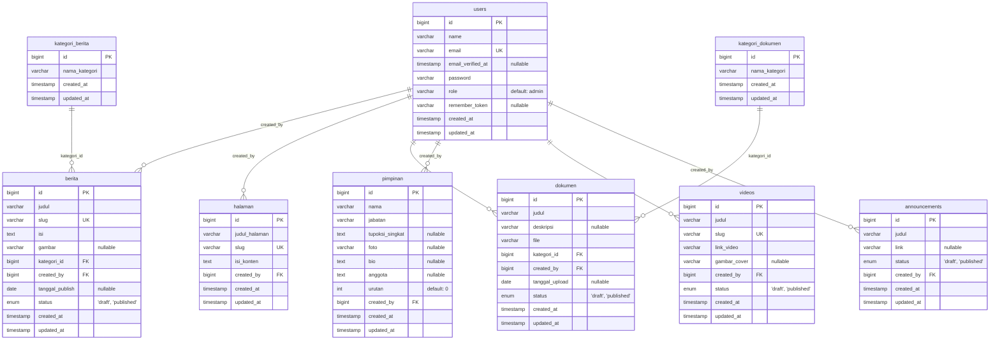

# Laporan Analisis & Dokumentasi ERD (Entity Relationship Diagram) Aktual
## Proyek Website Badan Kesatuan Bangsa dan Politik (Bakesbangpol) Kabupaten Banyuwangi
*Dokumen ini disusun untuk kebutuhan Proposal Tugas Akhir*

---

## 1. Kesimpulan Analisis Kesesuaian
Secara umum, struktur database yang diimplementasikan pada website **hampir sepenuhnya sesuai** dengan perencanaan awal (Planning ERD pada gambar). Namun, terdapat beberapa **penyesuaian, perbaikan struktural, dan penambahan fitur baru** yang dilakukan selama tahap pengembangan untuk memastikan performa, efisiensi database, serta alur kerja admin berjalan dengan baik.

Berikut adalah detail perbedaan dan penyesuaian yang telah dilakukan:

### A. Perbaikan Duplikasi pada Gambar Planning
* **Pada Gambar Planning:** Terdapat duplikasi entitas, yaitu ada **dua tabel** yang sama-sama dinamai `kategori_berita` di sisi kiri.
* **Pada Website Aktual:** Duplikasi ini dihilangkan. Hanya ada **satu tabel** `kategori_berita`, yang berelasi langsung dengan tabel `berita`. Sedangkan untuk dokumen, terdapat tabel terpisah bernama `kategori_dokumen` yang berelasi dengan tabel `dokumen`.

### B. Optimalisasi Tipe Data dan Indeks (Unique Constraint)
* **`halaman.slug` & `berita.slug`:** Pada gambar perencanaan, slug untuk halaman direncanakan memiliki tipe data `text`. Di database aktual, tipe data diubah menjadi `varchar(100)` dengan indeks **`UNIQUE`**. Hal ini dilakukan karena database MySQL tidak mendukung pembuatan indeks unik secara langsung pada tipe data `text` tanpa menentukan panjang awalan. Slug harus unik karena berfungsi sebagai pengenal halaman pada URL ramah SEO.
* **`berita.gambar` & `dokumen.deskripsi`:** Pada gambar perencanaan tertulis tipe data `text`. Pada sistem aktual, tipe ini disesuaikan menjadi `varchar(255)` yang lebih efisien karena hanya digunakan untuk menyimpan lokasi file (path) gambar/dokumen.

### C. Standardisasi Timestamp (Laravel Default)
* **Pada Gambar Planning:** Beberapa tabel tidak memiliki atribut `created_at` secara lengkap (seperti pada `kategori_dokumen`, `dokumen`, dan tabel duplikat `kategori_berita`).
* **Pada Website Aktual:** Semua tabel secara konsisten menggunakan fitur default Laravel `timestamps()`, yang secara otomatis membuat kolom `created_at` dan `updated_at` bertipe `timestamp`. Kolom ini sangat berguna untuk pencatatan riwayat data secara akurat.

### D. Penghapusan Atribut Redundan
* **`halaman.tanggal_upload`:** Kolom ini dihapus dari tabel `halaman` aktual karena fungsinya sudah sepenuhnya diwakili oleh kolom `created_at`.

### E. Penambahan Fitur Manajemen Status Konten
Untuk mengontrol konten sebelum dipublikasikan ke publik, ditambahkan kolom status bertipe `ENUM` pada beberapa tabel konten:
* **`berita.status`:** bertipe `ENUM('draft', 'published')` dengan default `'draft'`.
* **`dokumen.status`:** bertipe `ENUM('draft', 'published')` dengan default `'published'`.

### F. Penambahan Tabel Baru (Fitur Tambahan Website)
Untuk mengakomodasi kebutuhan fungsional tambahan pada website aktual Bakesbangpol Banyuwangi, terdapat 3 tabel baru yang tidak ada pada gambar perencanaan awal:
1. **`pimpinan`:** Digunakan untuk mengelola bagan organisasi, profil pejabat, serta daftar anggota staff Bakesbangpol Banyuwangi.
2. **`videos`:** Digunakan untuk mengelola galeri video publikasi (tautan embed YouTube).
3. **`announcements`:** Digunakan untuk mengelola informasi pengumuman penting atau banner informasi dinas.

---

## 2. Diagram ERD Aktual (Mermaid.js)
Gunakan kode diagram di bawah ini pada dokumen proposal Tugas Akhir Anda. Kode ini mendukung rendering visual otomatis pada platform seperti GitHub, VS Code (dengan ekstensi Markdown Preview), atau editor Markdown lainnya.



---

## 3. Kamus Data & Struktur Tabel Detail (SQL DDL)
Berikut adalah struktur rinci tabel database aktual (MySQL) yang berjalan pada sistem saat ini, lengkap dengan tipe data, batasan (constraints), dan penjelasan fungsinya.

### 3.1 Tabel: `users`
Menyimpan data pengguna (administrator) yang memiliki akses ke dashboard pengelolaan konten website.
* **Query Pembuatan (DDL):**
```sql
CREATE TABLE users (
    id BIGINT UNSIGNED AUTO_INCREMENT PRIMARY KEY,
    name VARCHAR(255) NOT NULL,
    email VARCHAR(255) NOT NULL UNIQUE,
    email_verified_at TIMESTAMP NULL,
    password VARCHAR(255) NOT NULL,
    role VARCHAR(50) DEFAULT 'admin',
    remember_token VARCHAR(100) NULL,
    created_at TIMESTAMP NULL,
    updated_at TIMESTAMP NULL
);
```

### 3.2 Tabel: `kategori_berita`
Menyimpan kategori pengelompokan berita (contoh: Berita Utama, Kegiatan, Sosialisasi).
* **Query Pembuatan (DDL):**
```sql
CREATE TABLE kategori_berita (
    id BIGINT UNSIGNED AUTO_INCREMENT PRIMARY KEY,
    nama_kategori VARCHAR(100) NOT NULL,
    created_at TIMESTAMP NULL,
    updated_at TIMESTAMP NULL
);
```

### 3.3 Tabel: `berita`
Menyimpan artikel, berita, atau publikasi kegiatan yang diposting oleh admin.
* **Query Pembuatan (DDL):**
```sql
CREATE TABLE berita (
    id BIGINT UNSIGNED AUTO_INCREMENT PRIMARY KEY,
    judul VARCHAR(100) NOT NULL,
    slug VARCHAR(100) NOT NULL UNIQUE,
    isi TEXT NOT NULL,
    gambar VARCHAR(255) NULL,
    kategori_id BIGINT UNSIGNED NOT NULL,
    created_by BIGINT UNSIGNED NOT NULL,
    tanggal_publish DATE NULL,
    status ENUM('draft', 'published') DEFAULT 'draft',
    created_at TIMESTAMP NULL,
    updated_at TIMESTAMP NULL,
    FOREIGN KEY (kategori_id) REFERENCES kategori_berita(id) ON DELETE RESTRICT,
    FOREIGN KEY (created_by) REFERENCES users(id) ON DELETE CASCADE
);
```

### 3.4 Tabel: `halaman`
Menyimpan informasi halaman dinamis/statis seperti Profil Instansi, Visi Misi, Tugas Pokok dan Fungsi (Tupoksi).
* **Query Pembuatan (DDL):**
```sql
CREATE TABLE halaman (
    id BIGINT UNSIGNED AUTO_INCREMENT PRIMARY KEY,
    judul_halaman VARCHAR(100) NOT NULL,
    slug VARCHAR(100) NOT NULL UNIQUE,
    isi_konten TEXT NOT NULL,
    created_by BIGINT UNSIGNED NOT NULL,
    created_at TIMESTAMP NULL,
    updated_at TIMESTAMP NULL,
    FOREIGN KEY (created_by) REFERENCES users(id) ON DELETE CASCADE
);
```

### 3.5 Tabel: `kategori_dokumen`
Menyimpan pengelompokan jenis berkas/dokumen PPID (contoh: Laporan Keuangan, Regulasi, Kebijakan).
* **Query Pembuatan (DDL):**
```sql
CREATE TABLE kategori_dokumen (
    id BIGINT UNSIGNED AUTO_INCREMENT PRIMARY KEY,
    nama_kategori VARCHAR(100) NOT NULL,
    created_at TIMESTAMP NULL,
    updated_at TIMESTAMP NULL
);
```

### 3.6 Tabel: `dokumen`
Menyimpan berkas publikasi PPID, surat keputusan, atau dokumen resmi lainnya yang dapat diunduh oleh masyarakat.
* **Query Pembuatan (DDL):**
```sql
CREATE TABLE dokumen (
    id BIGINT UNSIGNED AUTO_INCREMENT PRIMARY KEY,
    judul VARCHAR(100) NOT NULL,
    deskripsi VARCHAR(255) NULL,
    file VARCHAR(255) NOT NULL,
    kategori_id BIGINT UNSIGNED NOT NULL,
    created_by BIGINT UNSIGNED NOT NULL,
    tanggal_upload DATE NULL,
    status ENUM('draft', 'published') DEFAULT 'published',
    created_at TIMESTAMP NULL,
    updated_at TIMESTAMP NULL,
    FOREIGN KEY (kategori_id) REFERENCES kategori_dokumen(id) ON DELETE RESTRICT,
    FOREIGN KEY (created_by) REFERENCES users(id) ON DELETE CASCADE
);
```

### 3.7 Tabel: `pimpinan` (Tabel Baru)
Menyimpan data pimpinan dinas, pejabat struktural, kelompok fungsional, beserta daftar staf pendukung.
* **Query Pembuatan (DDL):**
```sql
CREATE TABLE pimpinan (
    id BIGINT UNSIGNED AUTO_INCREMENT PRIMARY KEY,
    nama VARCHAR(100) NOT NULL,
    jabatan VARCHAR(100) NOT NULL,
    tupoksi_singkat TEXT NULL,
    foto VARCHAR(255) NULL,
    bio TEXT NULL,
    anggota TEXT NULL,
    urutan INT DEFAULT 0,
    created_by BIGINT UNSIGNED NOT NULL,
    created_at TIMESTAMP NULL,
    updated_at TIMESTAMP NULL,
    FOREIGN KEY (created_by) REFERENCES users(id) ON DELETE CASCADE
);
```

### 3.8 Tabel: `videos` (Tabel Baru)
Menyimpan data tautan galeri video Bakesbangpol Banyuwangi dari YouTube untuk dipublikasikan ke beranda.
* **Query Pembuatan (DDL):**
```sql
CREATE TABLE videos (
    id BIGINT UNSIGNED AUTO_INCREMENT PRIMARY KEY,
    judul VARCHAR(100) NOT NULL,
    slug VARCHAR(100) NOT NULL UNIQUE,
    link_video VARCHAR(255) NOT NULL,
    gambar_cover VARCHAR(255) NULL,
    created_by BIGINT UNSIGNED NOT NULL,
    status ENUM('draft', 'published') DEFAULT 'draft',
    created_at TIMESTAMP NULL,
    updated_at TIMESTAMP NULL,
    FOREIGN KEY (created_by) REFERENCES users(id) ON DELETE CASCADE
);
```

### 3.9 Tabel: `announcements` (Tabel Baru)
Menyimpan data informasi penting, pengumuman singkat, atau tautan promosi banner.
* **Query Pembuatan (DDL):**
```sql
CREATE TABLE announcements (
    id BIGINT UNSIGNED AUTO_INCREMENT PRIMARY KEY,
    judul VARCHAR(255) NOT NULL,
    link VARCHAR(255) NULL,
    status ENUM('draft', 'published') DEFAULT 'draft',
    created_by BIGINT UNSIGNED NOT NULL,
    created_at TIMESTAMP NULL,
    updated_at TIMESTAMP NULL,
    FOREIGN KEY (created_by) REFERENCES users(id) ON DELETE CASCADE
);
```

---

## 4. Kode DBML untuk dbdiagram.io
Salin dan tempel kode di bawah ini langsung ke editor di [dbdiagram.io](https://dbdiagram.io/) untuk menghasilkan diagram ERD interaktif yang dapat diunduh dalam format PNG, PDF, atau SVG.

```dbml
// Database Markup Language (DBML) untuk Bakesbangpol Banyuwangi

Table users {
  id bigint [pk, increment]
  name varchar
  email varchar [unique]
  email_verified_at timestamp [null]
  password varchar
  role varchar [default: 'admin']
  remember_token varchar [null]
  created_at timestamp [null]
  updated_at timestamp [null]
}

Table kategori_berita {
  id bigint [pk, increment]
  nama_kategori varchar
  created_at timestamp [null]
  updated_at timestamp [null]
}

Table berita {
  id bigint [pk, increment]
  judul varchar
  slug varchar [unique]
  isi text
  gambar varchar [null]
  kategori_id bigint
  created_by bigint
  tanggal_publish date [null]
  status varchar [note: "enum: 'draft', 'published', default: 'draft'"]
  created_at timestamp [null]
  updated_at timestamp [null]
}

Table halaman {
  id bigint [pk, increment]
  judul_halaman varchar
  slug varchar [unique]
  isi_konten text
  created_by bigint
  created_at timestamp [null]
  updated_at timestamp [null]
}

Table kategori_dokumen {
  id bigint [pk, increment]
  nama_kategori varchar
  created_at timestamp [null]
  updated_at timestamp [null]
}

Table dokumen {
  id bigint [pk, increment]
  judul varchar
  deskripsi varchar [null]
  file varchar
  kategori_id bigint
  created_by bigint
  tanggal_upload date [null]
  status varchar [note: "enum: 'draft', 'published', default: 'published'"]
  created_at timestamp [null]
  updated_at timestamp [null]
}

Table pimpinan {
  id bigint [pk, increment]
  nama varchar
  jabatan varchar
  tupoksi_singkat text [null]
  foto varchar [null]
  bio text [null]
  anggota text [null]
  urutan int [default: 0]
  created_by bigint
  created_at timestamp [null]
  updated_at timestamp [null]
}

Table videos {
  id bigint [pk, increment]
  judul varchar
  slug varchar [unique]
  link_video varchar
  gambar_cover varchar [null]
  created_by bigint
  status varchar [note: "enum: 'draft', 'published', default: 'draft'"]
  created_at timestamp [null]
  updated_at timestamp [null]
}

Table announcements {
  id bigint [pk, increment]
  judul varchar
  link varchar [null]
  status varchar [note: "enum: 'draft', 'published', default: 'draft'"]
  created_by bigint
  created_at timestamp [null]
  updated_at timestamp [null]
}

// Hubungan Antar Tabel (Relasi)
Ref: berita.kategori_id > kategori_berita.id [delete: restrict]
Ref: berita.created_by > users.id [delete: cascade]

Ref: halaman.created_by > users.id [delete: cascade]

Ref: dokumen.kategori_id > kategori_dokumen.id [delete: restrict]
Ref: dokumen.created_by > users.id [delete: cascade]

Ref: pimpinan.created_by > users.id [delete: cascade]
Ref: videos.created_by > users.id [delete: cascade]
Ref: announcements.created_by > users.id [delete: cascade]
```
