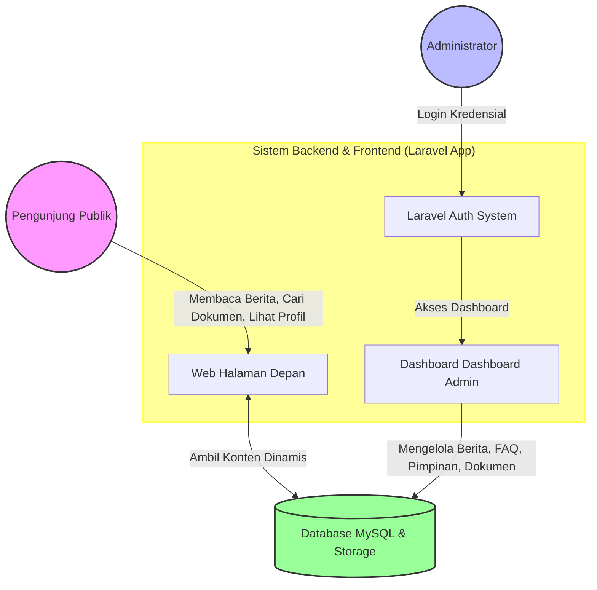
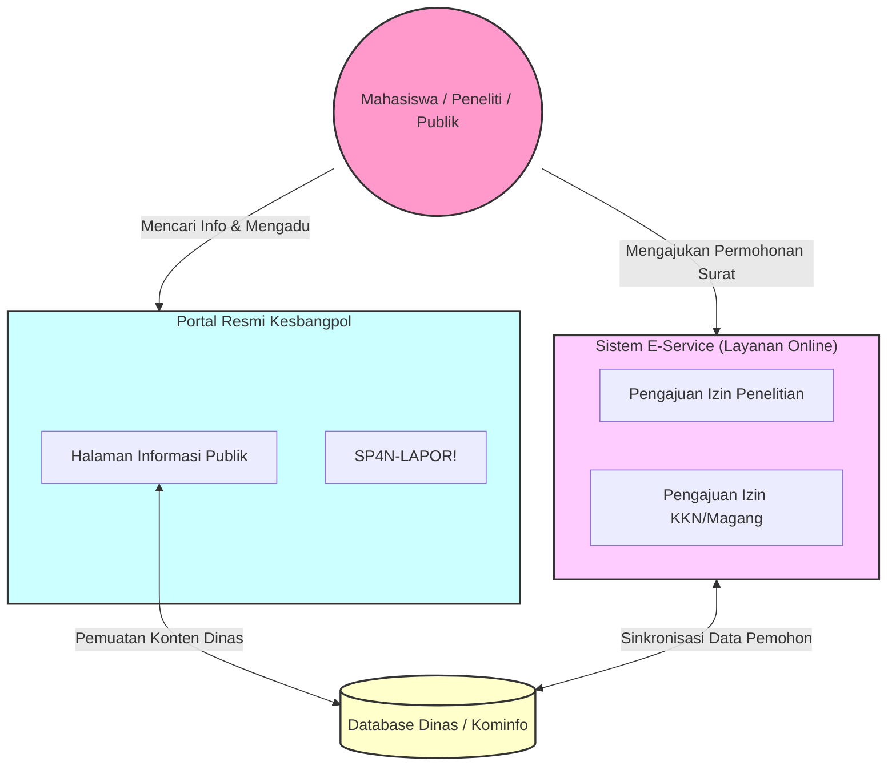

# Laporan Perbandingan & Gambaran Umum Sistem Website Bakesbangpol
## Website Hasil Pengembangan (Laravel CMS) vs. Website Resmi Aktual (kesbangpol.banyuwangikab.go.id)

Laporan ini menyajikan analisis perbandingan, kelebihan, kekurangan, serta gambaran umum arsitektur sistem antara **Website Bakesbangpol Banyuwangi Hasil Pengembangan (berbasis Laravel)** dengan **Website Resmi Aktif Bakesbangpol Banyuwangi (kesbangpol.banyuwangikab.go.id)** saat ini. 

Analisis ini dapat digunakan untuk melengkapi Bab Pembahasan/Analisis Perbandingan Sistem pada Proposal atau Laporan Tugas Akhir/Skripsi Anda.

---

## 1. Ilustrasi Visual Perbandingan Sistem

Berikut adalah gambaran visual perbandingan antara arsitektur sistem CMS modern yang dikembangkan dengan portal pemerintahan klasik:

---

## 2. Tabel Perbandingan Fitur & Teknis

| Parameter | Website Hasil Pengembangan (Laravel CMS) | Website Resmi Aktual (kesbangpol.banyuwangikab.go.id) |
| :--- | :--- | :--- |
| **Teknologi Utama** | PHP 8.x, Laravel MVC Framework, MySQL Database, Vite/CSS Modern. | PHP, CMS Generik (WordPress/Joomla) atau Framework Custom Kominfo. |
| **Tujuan Utama** | Pengelolaan Konten (CMS) yang cepat, informatif, modern, dan terdokumentasi rapi. | Portal informasi terintegrasi dan pusat pelayanan administratif online kabupaten. |
| **Desain Antarmuka (UI)** | **Modern & Minimalis**: Tata letak responsif, tipografi bersih, navigasi sederhana, tanpa iklan/widget mengganggu. | **Tradisional & Padat**: Penuh dengan widget eksternal, spanduk dinas berukuran besar, link eksternal yang padat. |
| **Kecepatan Akses (Performa)**| **Sangat Cepat**: Menggunakan query optimal Eloquent, CSS vanilla, dan aset terkompresi. | **Sedang**: Terkadang lambat akibat pemuatan script/widget pemkab, gambar besar yang tidak teroptimasi. |
| **Pengelolaan Profil** | Menggunakan fitur *Halaman Dinamis* terintegrasi WYSIWYG editor pada dashboard admin. | Menggunakan modul postingan bawaan CMS/Kominfo. |
| **Manajemen Dokumen (PPID)**| Tersedia pencarian dokumen instan dengan kategori yang rapi dan pengunduhan langsung. | Berkas diunduh melalui link unduhan PPID Utama Kabupaten Banyuwangi. |
| **Layanan Publik Daring** | Fokus pada visualisasi struktur, berita, dan pengumuman (belum ada pengajuan izin online). | **E-Service Izin Online**: Pengajuan izin penelitian, KKN, magang, PKL, dan pengaduan (SP4N-LAPOR!). |
| **Manajemen Pengguna** | Multi-admin dengan role yang dapat dikonfigurasi melalui menu User Management di dashboard. | Hak akses biasanya terikat dengan akun portal dinas/Kominfo satu pintu. |

---

## 3. Gambaran Umum Sistem Website Hasil Pengembangan (Laravel CMS)

Website yang Anda buat berfokus pada **sistem manajemen konten dinamis (Content Management System - CMS)** yang mandiri, responsif, dan mudah dipelihara.

### Karakteristik Utama:
* **Kemudahan Pengelolaan Konten:** Admin dapat merubah profil (Visi-Misi, Sejarah, Tupoksi) langsung dari editor teks di dashboard tanpa perlu menyentuh file HTML/Blade.
* **Struktur Database Terdokumentasi (Aktual):** Setiap tabel (seperti `berita`, `pimpinan`, `dokumen`, `announcements`) memiliki relasi kunci asing (*Foreign Key*) ke tabel `users` sebagai pencatat pembuat data (*created_by*), sehingga perubahan data terlacak dengan baik.
* **Optimasi SEO & URL Ramah Pengguna:** Menggunakan teknik *Slug* dinamis unik (misalnya `/publikasi/berita-baru-bakesbangpol`) yang otomatis digenerasi dari judul berita.

---

## 4. Gambaran Umum Website Resmi Bakesbangpol Banyuwangi Saat Ini

Website resmi aktual (kesbangpol.banyuwangikab.go.id) berfungsi sebagai **Portal Hub Pelayanan Publik Terpadu** yang melayani kebutuhan administrasi masyarakat secara daring.

### Karakteristik Utama:
* **Integrasi E-Service:** Menyediakan fitur transaksi online di mana mahasiswa/dosen/peneliti dapat mengunggah berkas persyaratan (seperti proposal atau surat pengantar kampus) untuk mendapatkan surat rekomendasi penelitian atau magang secara daring.
* **Integrasi SP4N-LAPOR!:** Halaman pengaduan masyarakat yang terhubung langsung ke sistem pengaduan nasional, bukan dikelola secara lokal pada database dinas itu sendiri.
* **Standardisasi Portal Kabupaten:** Tampilan visual, footer, widget, dan logo mengikuti panduan identitas visual Kabupaten Banyuwangi (oleh Dinas Kominfo).

---

## 5. Kesimpulan Rekomendasi Pengembangan (Future Work)

Untuk meningkatkan kualitas website yang Anda kembangkan agar dapat menyamai atau bahkan melampaui website resmi yang ada, Anda dapat menambahkan modul-modul berikut pada pengembangan selanjutnya:

1. **Modul Pengajuan Izin Penelitian Daring (E-Service):**
   * Membuat tabel `permohonan_izin` di database untuk menyimpan berkas upload (PDF proposal, KTM, Surat Pengantar Kampus).
   * Membuat halaman status permohonan agar pemohon dapat melacak status verifikasi surat mereka secara mandiri.
2. **Sistem Notifikasi Email/WhatsApp:**
   * Mengintegrasikan notifikasi (misal menggunakan Mail Laravel atau API WhatsApp Gateway) ketika surat rekomendasi disetujui oleh admin.
3. **Integrasi Widget Layanan Pengaduan:**
   * Menambahkan form aduan masyarakat lokal atau menyematkan widget SP4N-LAPOR! pada halaman Kontak.
