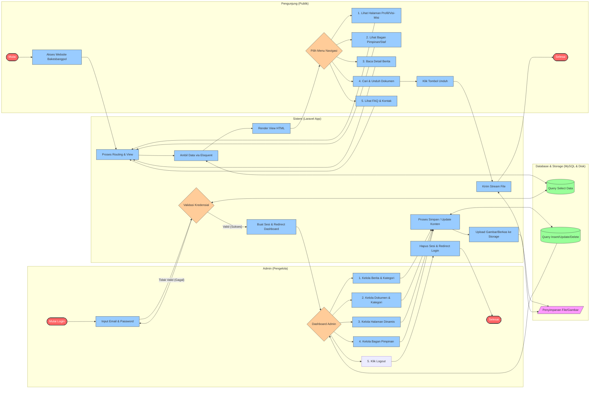
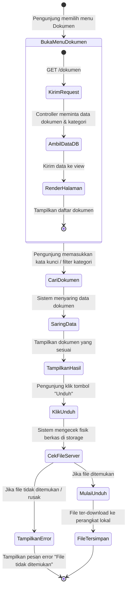
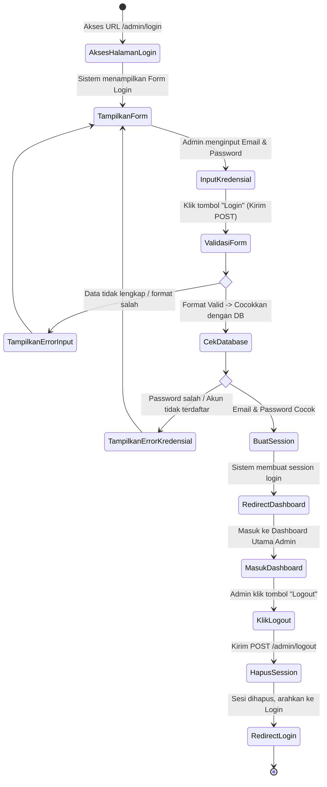
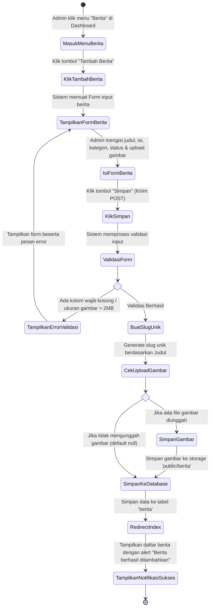
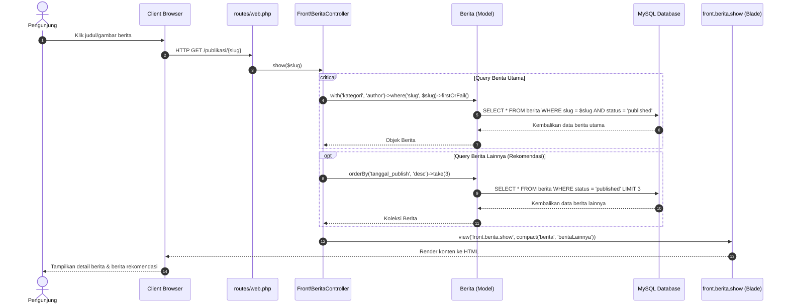
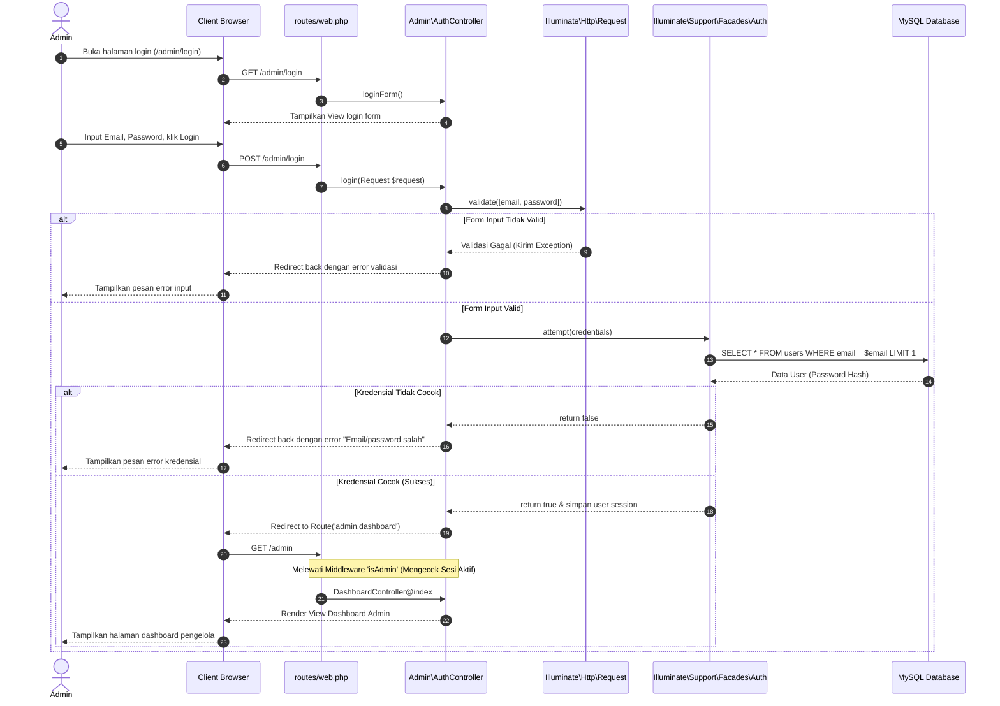
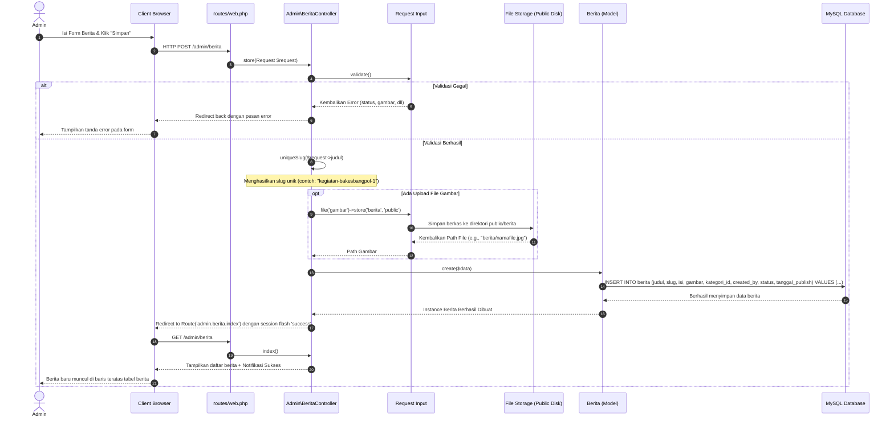

# Dokumentasi Diagram Sistem Berjalan dan Perancangan UML
## Website Badan Kesatuan Bangsa dan Politik (Bakesbangpol) Kabupaten Banyuwangi

Dokumen ini berisi analisis aliran sistem dan perancangan UML (*Unified Modeling Language*) yang disesuaikan dengan implementasi aktual pada website Bakesbangpol Kabupaten Banyuwangi. Dokumen ini dirancang agar dapat digunakan secara langsung sebagai lampiran Proposal, Laporan Tugas Akhir, atau Skripsi.

Semua diagram divisualisasikan secara interaktif menggunakan format **Mermaid.js** yang dapat ter-render secara otomatis pada VS Code (dengan ekstensi Markdown Preview), GitHub, GitLab, atau editor Markdown modern lainnya.

---

## 1. Flowchart Sistem Berjalan (Cross Functional Flowchart)

*Cross Functional Flowchart* (atau *Swimlane Flowchart*) ini menggambarkan alur aktivitas sistem berjalan yang dibagi ke dalam 4 (empat) peran/entitas tanggung jawab: **Pengunjung (Publik)**, **Admin (Pengelola)**, **Sistem (Laravel Web App)**, dan **Database/Storage**.



---

## 2. Activity Diagram

*Activity Diagram* berfokus pada aliran kontrol dari satu aktivitas ke aktivitas lainnya dalam suatu sistem. Di bawah ini disajikan 3 (tiga) *Activity Diagram* untuk alur-alur proses krusial pada website Bakesbangpol.

### A. Activity Diagram: Akses dan Unduh Dokumen (Pengunjung)
Menggambarkan aktivitas pengunjung mencari berkas (seperti dokumen regulasi, laporan keuangan PPID) dan mengunduhnya.



### B. Activity Diagram: Autentikasi Admin (Login & Logout)
Menggambarkan alur keamanan saat administrator melakukan login ke *dashboard* dan keluar (*logout*) dari sistem.



### C. Activity Diagram: Pengelolaan Konten (Tambah Berita Baru oleh Admin)
Menggambarkan alur aktivitas administrator saat menginputkan berita publikasi baru ke sistem.



---

## 3. Sequence Diagram

*Sequence Diagram* menunjukkan interaksi antar objek/komponen di dalam sistem yang disusun berdasarkan urutan waktu. Bagian ini menjelaskan interaksi arsitektur MVC (*Model-View-Controller*) Laravel pada website Bakesbangpol.

### A. Sequence Diagram: Membaca Detail Berita (Pengunjung)
Menjelaskan aliran data ketika pengunjung memilih dan membaca sebuah berita di halaman depan website.



### B. Sequence Diagram: Login Admin
Menjelaskan proses autentikasi administrator secara detail dari pengisian form hingga pembuatan sesi.



### C. Sequence Diagram: Menambah Berita Baru (Admin)
Menjelaskan interaksi objek saat admin membuat berita baru, termasuk proses unggah gambar cover dan penulisan ke database.



---

## 4. Cara Menyalin / Menggunakan Diagram ini di Proposal / Laporan

Jika Anda ingin memasukkan diagram ini ke dokumen Microsoft Word, Google Docs, atau presentasi PowerPoint, Anda dapat mengekspornya menjadi format gambar (PNG/SVG) dengan langkah-langkah berikut:

1. **Menggunakan VS Code (Rekomendasi):**
   * Pasang ekstensi **Markdown Preview Mermaid Support** dan **Markdown PDF** / **Markdown Preview Enhanced**.
   * Buka berkas ini di VS Code, klik kanan pada preview diagram, lalu pilih **Save Image as PNG**.
2. **Menggunakan Mermaid Live Editor (Online):**
   * Buka situs web [mermaid.live](https://mermaid.live/).
   * Salin kode diagram (blok berkode di dalam tanda ` ```mermaid ` dan ` ``` `) dari dokumen ini.
   * Tempelkan kode ke dalam kolom *Code* di Mermaid Live Editor.
   * Unduh gambar secara instan dengan mengklik tombol **PNG** atau **SVG** pada bagian bawah preview.
