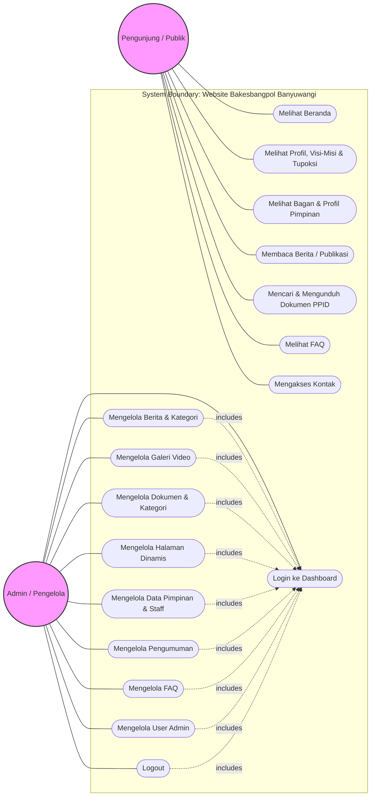
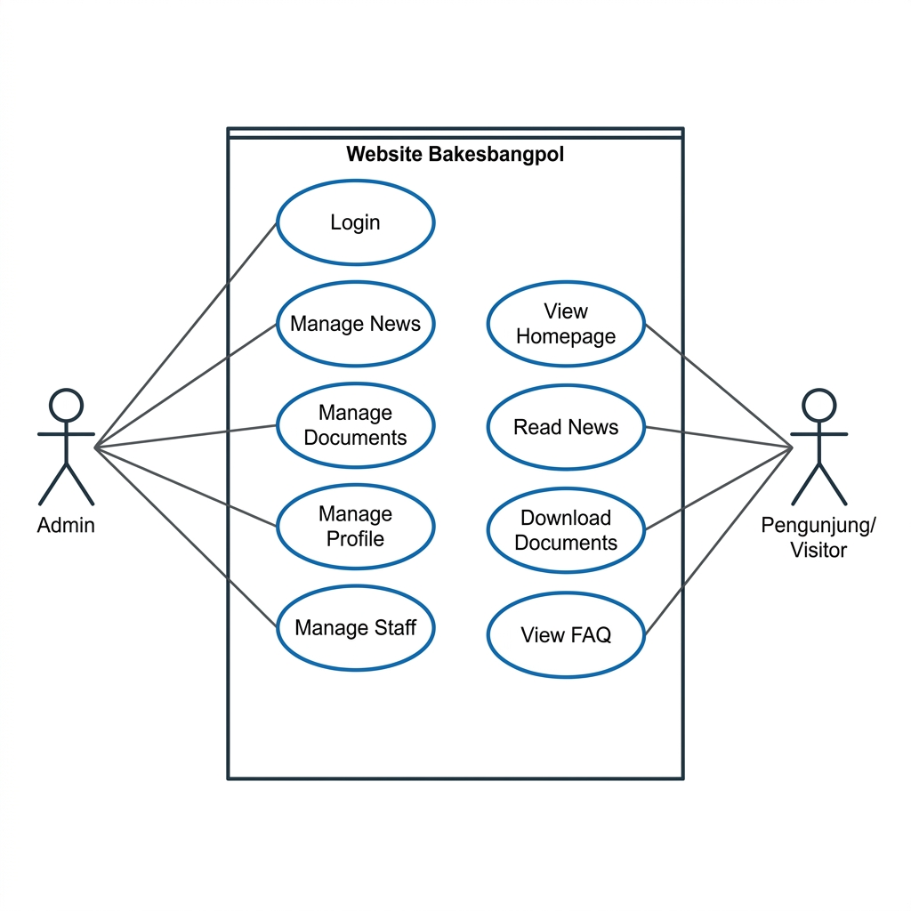

# Dokumentasi Use Case Diagram
## Website Badan Kesatuan Bangsa dan Politik (Bakesbangpol) Kabupaten Banyuwangi

Dokumen ini berisi diagram dan penjelasan fungsionalitas sistem (Use Case) dari website Bakesbangpol Kabupaten Banyuwangi yang sedang dikembangkan. Dokumen ini dapat digunakan langsung sebagai lampiran Proposal/Laporan Tugas Akhir.

---

## 1. Identifikasi Aktor (Actors)

Sistem ini memiliki 2 (dua) aktor utama dengan hak akses yang berbeda:

| No | Aktor | Deskripsi |
|---|---|---|
| 1 | **Admin (Pengelola)** | Pengguna internal yang memiliki hak akses ke panel admin (*dashboard*) setelah melakukan login. Bertanggung jawab mengelola seluruh konten dan informasi yang ditampilkan pada website. |
| 2 | **Pengunjung (Publik)** | Masyarakat umum atau pengguna eksternal yang mengakses website secara publik tanpa perlu melakukan login. Berperan sebagai konsumen informasi. |

---

## 2. Diagram Use Case (Mermaid.js)

Berikut adalah visualisasi interaktif dari Use Case Diagram menggunakan format **Mermaid.js**. Diagram ini akan ter-render otomatis jika dibuka di VS Code (dengan ekstensi Markdown Preview), GitHub, atau editor Markdown modern lainnya.

---

## 3. Gambar Use Case Diagram (Ekspor)

Jika Anda membutuhkan format gambar gambar langsung (PNG) untuk disisipkan ke dokumen MS Word atau Google Docs, file gambar dapat diakses di:
**[wireframe/use_case_diagram.png](file:///c:/laragon/www/BakesbangpolBanyuwangi/wireframe/use_case_diagram.png)**

*(Preview Gambar)*:

---

## 4. Deskripsi Use Case (Use Case Description)

### A. Use Case Utama - Pengunjung (Public)

1. **Melihat Beranda**
   * **Deskripsi:** Pengunjung membuka halaman utama website untuk melihat informasi sekilas seperti berita terbaru, video publikasi, pengumuman, dan banner dinas.
2. **Melihat Profil, Visi-Misi & Tupoksi**
   * **Deskripsi:** Pengunjung membaca informasi dasar instansi (Profil, Sejarah, Visi, Misi, dan Tugas Pokok & Fungsi Bakesbangpol).
3. **Melihat Bagan & Profil Pimpinan**
   * **Deskripsi:** Pengunjung melihat struktur organisasi Bakesbangpol, daftar pejabat struktural, jabatan, foto, serta profil singkat pimpinan.
4. **Membaca Berita / Publikasi**
   * **Deskripsi:** Pengunjung menjelajahi daftar artikel berita, memfilter berdasarkan kategori berita, dan membaca detail konten berita.
5. **Mencari & Mengunduh Dokumen PPID**
   * **Deskripsi:** Pengunjung mencari berkas publikasi (dokumen PPID pembantu, regulasi, laporan keuangan) dan mengunduh (*download*) berkas tersebut secara langsung.
6. **Melihat FAQ**
   * **Deskripsi:** Pengunjung membaca daftar pertanyaan yang sering diajukan beserta jawaban resmi dari dinas.
7. **Mengakses Kontak**
   * **Deskripsi:** Pengunjung melihat informasi alamat kantor, peta lokasi, nomor telepon, email, serta media sosial resmi instansi.

### B. Use Case Utama - Admin (Pengelola)

1. **Login ke Dashboard**
   * **Deskripsi:** Admin melakukan autentikasi dengan memasukkan email dan password untuk masuk ke panel pengelolaan konten.
2. **Mengelola Berita & Kategori**
   * **Deskripsi:** Admin menambah, mengubah, menghapus, atau menampilkan data berita, mengatur kategori berita, mengunggah gambar cover berita, serta menyetel status postingan (`draft` / `published`).
3. **Mengelola Galeri Video**
   * **Deskripsi:** Admin mengelola video publikasi yang bersumber dari embed link YouTube untuk ditampilkan pada galeri.
4. **Mengelola Dokumen & Kategori**
   * **Deskripsi:** Admin mengunggah berkas dokumen (PDF, Doc, dll.), mengelola data dokumen, serta mengelompokkannya ke dalam kategori dokumen PPID.
5. **Mengelola Halaman Dinamis**
   * **Deskripsi:** Admin mengedit konten statis/dinamis seperti halaman Profil, Visi-Misi, dan Tupoksi secara fleksibel menggunakan text editor (WYSIWYG).
6. **Mengelola Data Pimpinan & Staff**
   * **Deskripsi:** Admin menambah, mengubah, menghapus data pejabat struktural, mengunggah foto pimpinan, serta mengatur nomor urutan tampilannya.
7. **Mengelola Pengumuman**
   * **Deskripsi:** Admin mengelola konten pengumuman/informasi mendesak serta banner dinas yang muncul di halaman beranda.
8. **Mengelola FAQ**
   * **Deskripsi:** Admin mengelola daftar pertanyaan dan jawaban umum seputar layanan.
9. **Mengelola User Admin**
   * **Deskripsi:** Admin super dapat menambah, menyunting, atau mencabut hak akses bagi akun administrator lainnya.
10. **Logout**
    * **Deskripsi:** Admin keluar dari panel pengelolaan konten untuk mengakhiri sesi kerja dengan aman.
